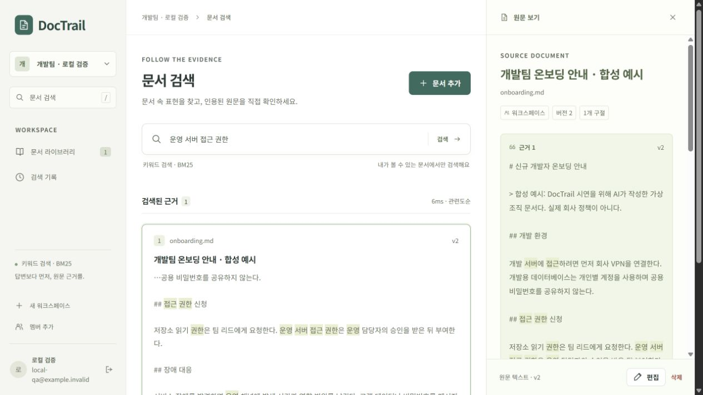

# DocTrail

**소규모 개발 조직을 위한 권한 기반 문서 검색과 근거 확인 서비스.**

화면은 **React + TypeScript + Vite**, 서비스 백엔드는 **Java 21 + Spring Boot**다. Python은 데이터 준비·학습·오프라인 평가와 선택적 검색 모델 추론에 사용한다. 기존 Python 서비스와 동결 실험은 보존한다. [Java 전환 범위와 검증](docs/JAVA-MIGRATION.md), [React 선택 이유](docs/decisions/0003-react-frontend.md), [화면 구조와 검증 실행법](docs/FRONTEND.md)을 참고한다.

새 팀원이 온보딩·운영 문서에서 정보를 찾을 때, 볼 수 있는 문서의 어느 부분이 근거인지 확인하는 흐름을 만든다. 한국어·영어 문서를 대상으로 검색 기준선부터 임베딩·하이브리드·리랭킹·미세조정까지 비교하는 개인 AI Engineer 포트폴리오 프로젝트다.

## 현재 범위

문서 등록 → 검색 → 원문 근거 확인을 로컬에서 구현·검증했다. 로그인·작업공간·나만 보기 권한, 수정·삭제·재처리, 검색 기록·피드백도 실제 API에 연결했다. 기본 BM25 외에 E5 의미 검색·혼합·BGE 재정렬을 선택할 수 있으며 실제 로컬 GPU와 Java·React 연결을 합성 자료로 검증했다. 생성형 질의응답·서비스 배포는 후속 단계이며, 검색 임베딩의 제한 미세조정은 실제로 수행했다. [현재 상태](docs/STATUS.md), [모델 서비스 실행·한계](docs/MODEL-SERVING.md).

M2에서는 공개 한·영 문서 313개, AI 질문 초안 240개와 리비전 후 활성 질문 239개를 준비했다. 개발용 양성 질문 59개에서 top-5 청크의 필수 근거 완전 회수는 **30/59**, 주석상 교차 언어 질문은 **1/23**이었다. 사용자 검수는 0개이고 test 질문 성능은 열지 않았다. 이 실패를 출발점으로 검색 모델을 비교한다. [실측·실패 분석](experiments/README.md), [데이터 재현](data/README.md), [데이터 카드](docs/DATA-CARD.md)를 제공한다.

M3 첫 로컬 GPU 비교는 같은 입력에서 **BM25 30/59 → E5 임베딩 29/59 → 혼합 27/59 → 혼합+리랭커 36/59**였다. 나빠진 방법도 보존했다. 이 수치는 동결 Python 오프라인 dev 평가이며 Java 서비스 성능으로 재해석하지 않는다. [실행법](docs/M3-RUNBOOK.md)과 [비교 설계](docs/M3-DESIGN.md)를 참고한다.

후속 비교에서는 두 검색기의 후보를 같은 깊이로 읽고 중복을 제외해 50개를 채우는 정책을 사전 고정했다. 같은 BGE로 다시 순위를 매긴 결과 **37/59**로 1문항 회복·추가 퇴보 0문항이었다. 후보 자체에 모든 근거가 있는 질문도 38/59에 그쳐 누락 문제가 남았다. 기존 모델 입력의 잘림과 근거 토큰 보존을 따로 검사한 [후속 분석](docs/M3-CANDIDATE-ANALYSIS.md)에 개선·한계·재현 근거를 함께 남겼다. 모두 사용자 검수 전 dev 결과다.

M4에서는 원래 train 안에서 학습64·내부 검증16개의 AI 질문과 독립 검토를 준비했다. 대체 정답·모호한 후보·잘린 입력을 구분해 검토했고, 첫 GPU 수치 실패도 보존했다. 초기 loss scale만 바꾼 후속 probe를 통과한 뒤 E5 전체 가중치를16회 실제 갱신했다. [준비·실행·품질 기록](docs/M4-READINESS-RESULTS.md)과 [재현 실행법](docs/M4-RUNBOOK.md)에 성공·실패·한계를 함께 남긴다. 학습 완료와 검색 개선·서비스 채택은 별개다.

별도 사전 고정 dev 비교에서 새 E5 base→학습 저장본의 전체 근거 회수는 **후보50 기준34→47/59, 상위5 기준29→37/59**였다. @5에서14개 회복·6개 퇴보했으며, 다중 문서 질문은1→0/7로 나빠졌다. [사례와 한계](docs/M4-MAIN-DEV-ANALYSIS.md)를 보존하고 별도 운영 검증으로 이어간다. 사용자 검수0·test 잠금·서비스 미채택 상태이며, 공개 CI는 가중치 없이 저장 결과를 재생한다.



## 시작하기

서비스 실행에는 Java 21과 Node.js 22.12 이상이 필요하다. CI는 Node.js 24를 사용한다. Maven 3.9.16은 저장소 wrapper가 내려받아 체크섬을 확인한다. AI 데이터·실험과 이전 Python 구현의 검증에는 Python 3.11과 [uv](https://docs.astral.sh/uv/)를 사용한다.

Windows에서는 저장소 루트에서 `./scripts/start.ps1` 한 번으로 설치·빌드·실행할 수 있다. 수동 실행은 다음과 같다.

```powershell
cd web
npm ci
npm run build
cd ..
./server/mvnw.cmd -B -f server/pom.xml verify
java -jar server/target/doctrail-server-0.1.0.jar
```

브라우저에서 `http://127.0.0.1:8000`을 열고 계정과 작업공간을 만든다. Markdown, UTF-8 텍스트, 텍스트가 포함된 PDF를 등록하고 검색한다. Java 기본 DB는 `var/doctrail-java.sqlite3`이며 기존 Python DB를 자동으로 옮기거나 덮어쓰지 않는다. 기본 계정이나 고정 비밀번호는 없다. macOS/Linux에서는 위의 `mvnw.cmd` 대신 `mvnw`를 사용한다.

이전 구현은 `./scripts/start.ps1 -Backend Python`으로 실행한다. AI 실험 실행법은 [M3-RUNBOOK](docs/M3-RUNBOOK.md)을 따른다. 두 서비스를 같은 포트·같은 DB에 동시에 실행하지 않는다.

개발 중에는 API 서버와 별도로 `web/`에서 `npm run dev`를 실행한다. 프런트엔드 개발 서버가 `/api`를 로컬 API 서버로 전달한다.

## 검증

```powershell
./server/mvnw.cmd -B -f server/pom.xml verify
uv run --group retrieval pytest
uv run --group retrieval python -m scripts.verify_java_service --output .local/java-check.json
cd web
npm run typecheck
npm run build
```

브라우저 회귀 검사는 **프런트엔드 빌드 → Java JAR 재패키징**을 먼저 마친 뒤 `web/`에서 `npx playwright install chromium`, `npm run test:e2e`로 실행한다. 별도의 합성 DB와 로컬 임시 포트를 사용한다. [검증 범위와 실행법](docs/FRONTEND.md)을 참고한다.

## 문서

- [제품과 사용자 문제](docs/product.md), [기존 서비스·채용 조사](docs/research.md)
- [구조](docs/architecture.md), [데이터·평가 설계](docs/data-evaluation.md), [단계별 완료 기준](docs/roadmap.md)
- [API 계약](docs/API-CONTRACT.md), [결정 기록](docs/DECISIONS.md)
- [Git 협업 규칙](CONTRIBUTING.md), [AI와 사용자 기여 기록](docs/CONTRIBUTIONS.md)
- [실험 실행·실패 분석](experiments/README.md), [운영·복구](docs/OPERATIONS.md), [시연·면접 준비](docs/DEMO.md)
- [M2 평가 계약](docs/M2-EVALUATION.md), [직접 검수와 면접 설명](docs/M2-LEARNING.md)
- [M3 비교 설계](docs/M3-DESIGN.md), [실측과 실패 분석](docs/M3-ANALYSIS.md), [모델 실행](docs/M3-RUNBOOK.md)
- [후보 선택 후속 설계](docs/M3-CANDIDATE-DESIGN.md), [후속 실측·토큰 잘림 분석](docs/M3-CANDIDATE-ANALYSIS.md)
- [Java 서비스 전환](docs/JAVA-MIGRATION.md), [Java 선택 ADR](docs/decisions/0002-java-service.md)
- [React 화면 구조·검증](docs/FRONTEND.md), [React 선택 ADR](docs/decisions/0003-react-frontend.md)
- [Java·Python 모델 연결과 실행](docs/MODEL-SERVING.md), [추론 경계 ADR](docs/decisions/0004-model-serving.md), [실제 로컬 GPU 운영 검사](experiments/results/m3-model-service-v1.json)
- [M4 학습 가설·데이터 기준](docs/M4-DESIGN.md), [train 자료와 재현 방법](data/training/README.md)
- [자동 후속 실행과 승인 경계](docs/AUTONOMY.md)

## 라이선스와 사실 구분

프로젝트 코드는 MIT License다. 공개 문서·데이터셋은 각 원출처의 이용 조건을 따르며 코드의 MIT 라이선스로 재지정하지 않는다. 합성 예시와 공개 원문, 계획과 실측, 자동 검수와 사용자 검수를 구분한다. AI가 설계·구현·실험·문서 작성을 지원하며, 사용자의 직접 판단·검증은 별도로 기록한다.
