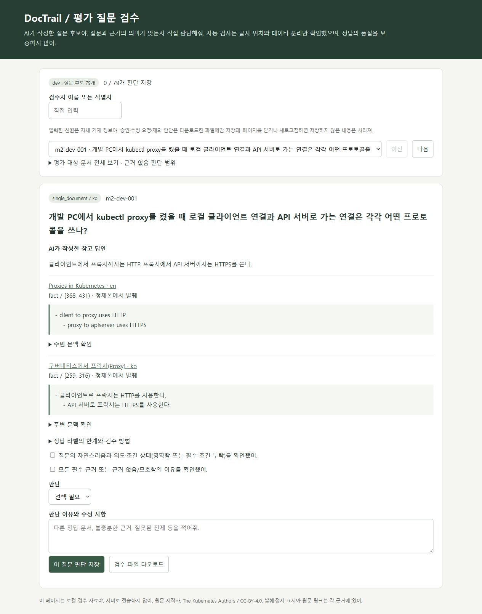

# M2를 면접에서 설명하기

이 문서는 실제 수행한 작업을 이해하기 위한 자료다. 아직 사용자가 읽고 설명할 수 있음을 검증하지 않았다. 작성·구현·실험은 AI 지원으로 진행했고 직접 판단은 [기여 기록](CONTRIBUTIONS.md)과 구분한다.

## 해결하려던 문제

“문서를 검색했는데 관련 문서만 나오고 답이 있는 구절은 못 찾는다”는 문제를 측정 가능하게 만들었다. 소규모 개발 조직의 한·영 운영 문서 검색을 대상으로 하지만 실제 회사 자료 대신 출처가 고정된 Kubernetes 공개 문서를 사용했다.

## 선택한 방법과 대안

처음부터 생성 답변을 붙이면 파서·검색·답변의 실패가 섞인다. 따라서 문서 등록과 권한 확인, BM25, 정확한 원문 구절을 먼저 연결했다. BM25는 외부 모델 비용 없이 동작하고 어휘 검색의 실패를 설명하기 쉽다. 의미 검색은 다음 비교 대상이다.

원본 문서를 무작위로 나누는 대신 번역·정확 중복·유사 중복을 연결한 그룹으로 분할했다. 한국어 문서를 학습하고 같은 영어 번역으로 시험하는 누출을 줄이기 위해서다. 단, 어휘가 다른 의미 중복은 남을 수 있다. 검색 인덱스에는 모든 문서가 있어도 되지만 dev/test 질문·정답은 학습에 쓰지 않는다.

Hugo 태그를 전부 지우는 방식은 외부 포함 본문을 잃는다. 미지원 구문이 있는 문서를 제외하는 보수적 방법으로 313개를 확보했다. 최초 1,000개 목표보다 작고 참조 문서에 편향되었다. 수량과 품질의 교환 관계를 숨기지 않는다.

## 실험 결과와 해석

양성 dev 59질문에서 근거 문서가 상위 후보에 한 번이라도 나온 질문은 35개였다. 하지만 상위 5청크에 모든 필수 사실의 근거가 있는 질문은 30개였다. 문서 적중과 답을 뒷받침할 구절의 회수는 다르다. 여러 문서 질문은 7개 중 1개, 주석상 교차 언어가 필요한 질문은 23개 중 1개만 모든 근거를 찾았다.

313문서를 실제 API로 올린 로컬 HTTP 검색 32건은 모두 성공했고 p50 약 256ms, p95 약 385ms였다. 이는 동시 사용자 부하나 인터넷 배포 성능이 아니다. 기능 성공·응답 속도·검색 품질은 서로 다른 증거다.

## 실패 사례와 다음 실험

- `m2-dev-011`: 한국어로 ExecCredential v1의 cluster 정보를 묻지만 주석한 영어 문서가 상위 결과에 없다. 동시에 주석 span이 청크 경계에 걸린다. 교차 언어와 청크 문제를 둘 다 기록한다.
- `m2-dev-040`: `/metrics` RBAC 문서를 찾았지만 필요한 규칙 구간을 상위 5청크에서 놓쳤다. 문서 후보를 찾는 것만으로 해결되지 않는다.
- `m2-dev-032`: 주석 span 전체를 담는 청크가 없어 현재 완전 포함 규칙으로 적중할 수 없다. 다음 청크 실험에서 다루고 기준선 라벨은 점수를 보고 고치지 않는다.
- `m2-dev-055`: 검색 평가 전에 두 문서가 꼭 필요한지 AI 검토에서 이의가 나왔다. 원본을 유지하고 dev v1.1에서 제외했다. 수정 정답이 확정된 것은 아니다.
- 근거 없음 후보 12개 모두 검색 결과가 나왔다. BM25 점수 양수를 답변해도 된다는 신호로 쓰면 안 된다. 보류 정책은 추후 별도로 평가한다.

다음은 고정 dev에서 다국어 임베딩·혼합·리랭커를 비교하는 것이다. 청크 실험은 별도 실행으로 분리하고 학습은 실패가 반복되는 원인과 로컬 자원을 확인한 뒤 선택한다. Test 질문 성능은 아직 열지 않는다. 모델 학습이나 검색 개선 성과는 현재 포트폴리오에 쓰면 안 된다.

## 직접 확인할 부분

검수 화면에서 우선 dev의 단일 문서·다중 문서·근거 없음·조건 불명확 질문을 하나씩 읽어 본다. 질문이 자연스러운지, 제시한 근거만으로 답할 수 있는지, 다중 문서가 실제로 필요한지, 코퍼스의 다른 문서에 답이 있을 수 있는지 판단한다. 수정이 필요하거나 모르면 승인하지 않고 이유를 적는다. AI가 만든 참고 답안을 정답으로 가정하지 않는다. 실제 제출한 검수만 별도로 기록한다.

## 예상 질문과 답변

**왜 RAG부터 만들지 않았나요?** 문서 파싱과 검색이 실패하면 생성 답변이 그 실패를 가릴 수 있어서 먼저 원문 근거 회수를 측정했습니다. 지금은 검색 서비스이며 생성 답변은 구현하지 않았습니다.

**50.85%는 정확도인가요?** 아닙니다. AI가 주석한 양성 개발 질문 59개 중 상위 5청크에서 모든 필수 근거 그룹을 회수한 비율입니다. 답변 정확도가 아니며 사람 검수 0개, 불완전 정답 라벨이라는 한계가 있습니다.

**240개 평가 질문을 만들었나요?** 최초 AI 후보가 240개입니다. 평가 전에 한 후보의 다중 문서 조건이 불확실해 원본을 남기고 활성 후보를 239개로 줄였습니다. Dev 79개만 검색 평가했고 test 160개는 구조·출처 검사만 했습니다.

**모델보다 데이터를 먼저 바꿔야 하지 않나요?** 현재 데이터 결함과 검색 실패를 구분하는 중입니다. 세 질문은 청크 경계상 완전 적중이 불가능했고 교차 언어 문서 회수도 약했습니다. 라벨 검수, 청크 설정, 검색 모델을 별도 실험으로 바꾸어 원인을 확인할 계획입니다.

**직접 한 부분은 무엇인가요?** 프로젝트 목적, 국내 채용·한영 문서 범위, 본인 계정 Git 규칙과 비용 승인 조건은 사용자가 정했습니다. AI가 설계·구현·테스트·실험·문서화를 지원했습니다. 아직 사용자의 직접 질문 검수와 모델 결과 판단은 수행 기록이 없습니다. 실제로 수행하면 기여 기록에 추가합니다.
