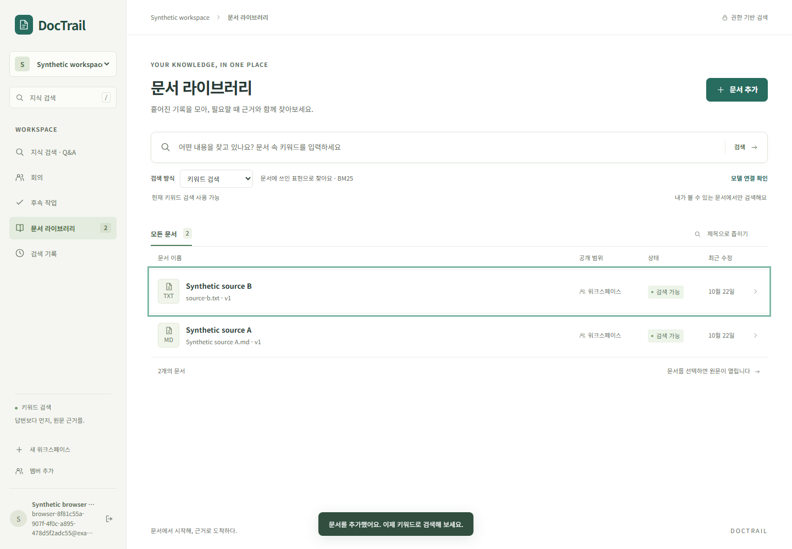
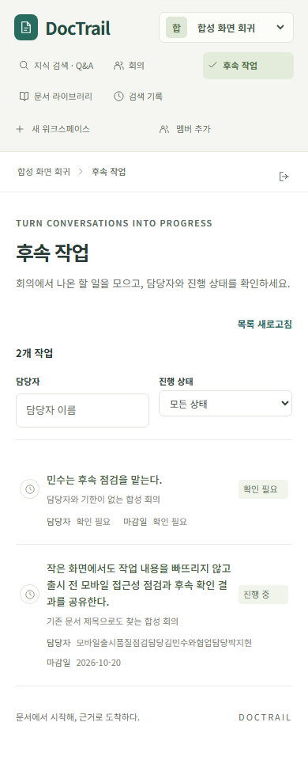

# 회의 화면과 전체 사용자 흐름 검증

## 2026-10-22 · 실패 안내와 원문 닫기 후 초점 복귀

실제 Java 서비스와 패키징한 React 화면에서 문서·회의·작업·지식검색의 1440/390px 흐름을 확인했다. 일반 합성 문서와 합성 모델 응답을 사용했다. 실제 모델 품질이나 사용자 검수 결과는 아니다.

재분석에 실패하면 기존 분석과 사용자 수정본을 보존하면서 복구 방법을 안내한다. 사용자에게 필요 없는 내부 오류 코드는 화면에서 제거했다. 키보드로 원문이나 인용을 열고 닫으면 열었던 버튼으로 초점을 돌린다. 다른 문서 업로드·화면 이동·검색 변경·로그아웃·버튼 제거 이후에는 오래된 버튼으로 돌아가지 않는다.

독립 코드 검토에서 추가 업로드가 이전 문서의 초점 대상을 물려받는 문제를 찾아 실제 브라우저에서 재현했다. 문서 ID까지 결속하고 업로드 시 대상을 초기화한 뒤 관련 4개 검사가 통과했다. 첫 재현은 기존 대화상자 초점 복귀가 끝나기 전에 Enter를 눌러 생긴 검사 오류였으며, 안정된 별도 재현에서 확인한 제품 오류와 구분해 보존했다.

| 검증 범위 | 확인한 결과 |
| --- | --- |
| 초기 전체 여정 | 두 화면 폭, 대표 30개 화면 상태, 관측한 가로 넘침 없음 |
| 빈 결과·시간 초과 | 초기 도구의 잘못된 오류 형식과 완료 대기 누락을 보존하고 별도 보완 실행에서 완료 상태와 수동 재시도 확인 |
| 첫 수정 | 초점 3개·재분석 실패 1개·기존 원문 복구 8개, 서로 다른 12개 검사 통과 |
| 업로드 결함 수정 후 최종 소스 | 영향받는 초점 4개 통과(7.8초), 타입·빌드·오프라인 패키징 통과 |
| 독립 최종 코드 검토 | 남은 blocker 0개. 실행·시각적 수용 판단과 구분 |

12개와 4개는 겹치므로 16개 고유 검사로 합산하지 않는다. 패키징은 Java 단위 검사를 생략한 빌드이며 정확한 커밋의 전체 CI는 별도로 확인한다. 최종 실행 3회의 소유 프로세스 39개 PID/생성 시각 모두 부재를 재확인했다. 이전 실제 모델 실행의 종료 실패를 이 결과로 통과 처리하지 않는다.



[390px 원문·인용 화면](images/source-citation-open-390.png)도 실제 Java/합성 응답 실행에서 얻었다. 작업 AI와 부모 AI가 확인했으며 사람이 확인한 결과는 아니다. 스크린리더·다른 브라우저·실제 사용자 사용성 검수는 남아 있다. [공개 검증 결과](../experiments/results/meeting-product-walkthrough-v1.json)에 소스·바이너리·실패·검사·이미지 연결과 한계를 기록했다.

최종 소스에서 관련 검사 재현:

```powershell
npm --prefix web run typecheck
npm --prefix web run build
./server/mvnw.cmd -o -B -q -f server/pom.xml -DskipTests package
npm --prefix web run test:e2e -- source-focus.spec.ts
npm --prefix web run test:e2e -- meeting-ready.spec.ts --grep "failed reanalysis visibly"
npm --prefix web run test:e2e -- knowledge-source-recovery.spec.ts
```

## 2026-10-20 · 회의 제목 검색과 후속 작업 화면 개선

2026-10-20. 실제 Java 서비스와 패키징된 React 화면에서 두 문제를 재현하고 수정했다. 데이터와 모델 응답은 합성 fixture이며 실제 LLM·사용자 검수는0이다. 전체 Phase1 품질 완료를 뜻하지 않는다.

## 사용자에게 달라진 동작

분석 편집에서 회의 제목을 바꾸면 카드에는 새 제목이 표시됐지만, 목록 검색은 원래 문서 제목과 요약만 검사했다. 이제 표시된 분석 제목도 검색한다. 원래 문서 제목과 요약 검색은 유지하며 검색 서버나 문서 원문을 바꾸지 않았다.

후속 작업 목록은1024px에서 마감일,390px에서 담당자와 마감일을 숨겼다. 이제 두 항목에 이름표를 붙이고 좁은 화면에서는 다음 줄로 배치한다. 없는 값은 ‘확인 필요’로 남기며 긴 작업 내용·담당자도 줄바꿈한다. 작업 행의 버튼 동작과 원문 이동은 유지한다.

| 실제 확인 | 결과 |
| --- | --- |
| 수정 전 기존 등록·원문·편집·작업 흐름 | 1개 통과, 검사6.9초 / suite8.4초 |
| 별도 수정 전 재현 | 두 문제 모두9.639321초의 실제 화면 실행에서 확인 |
| 수정 후 기존 흐름 | 1개 통과,6.8초 |
| 신규 회귀 첫 실행 | 선택자 timeout1개,45.1초. 키보드·태블릿·모바일 단계는 미실행으로 보존 |
| 선택자만 수정한 신규 회귀 | 1개 통과,3.3초 / suite4.5초 |
| 타입 검사·화면 빌드·오프라인 Java 패키징 | 통과. 패키징은 `-DskipTests`이며 Java 단위 검사 실행으로 보고하지 않음 |

수정 후 서로 다른 두 시나리오가 두 실행에서 통과한 것이다. 중간 실행을 더해 큰 검사 수로 표현하지 않는다. 신규 회귀는 수정 제목·원래 제목·요약 검색,1440/1024/390px의 담당자·기한·빈 값·긴 문자열·가로 넘침, 세 폭에서 Tab/Enter, Space로 작업 열기, 모바일의 정확한 원문 구절과 상세 화면 복귀를 확인했다.

초기 별도 재현 도구의 선택자 실패도 남겼다. 첫 launcher 보고의 `serverStopped=true`가 실제 child JVM이 아니라 Oracle javapath shim의 종료를 가리킨 것을 확인했다. 부모 PID·명령·격리 포트로 소유권을 확인해 해당 JVM을 종료하고 원래 보고와 정정을 함께 보존했다. 이후에는 실제 `java.home` 실행파일을 사용했고 최종 소유 JVM은0, 다른 프로젝트 JVM3개는 유지했다.

## 화면과 증거



[태블릿 화면](images/meeting-task-metadata-1024.png)도 실제 실행의 합성 데이터 화면이다. AI가 시각적으로 확인했으며 사용자 사용성 검사로 바꾸어 기록하지 않는다.

[공개 검증 요약](../experiments/results/meeting-visual-acceptance-v1.json)은 local projection의 exact copy다(`a8856e7f…`). [복사·hash 확인](../experiments/results/meeting-visual-acceptance-publication-v1.json)은 원본 receipt `d7553c03…`, 현재 코드10개·빌드 artifact2개, 보존 artifact12개, 최종 screenshot5개와 공개 image2개의 연결을 기록한다. 부모는 세 파일의 변경과 신규 검사, CSS, 수정 전후 화면을 확인했다.

## 재현

화면 변경 뒤 빌드와 Java 패키징을 먼저 수행한다. Java21·Node 환경에서 다음의 두 관련 시나리오를 선택할 수 있다. 이 안내는 새로운 실행 결과가 아니다.

```powershell
npm --prefix web run typecheck
npm --prefix web run build
./server/mvnw.cmd -o -B -q -f server/pom.xml -DskipTests package
npm --prefix web run test:e2e -- meeting-ready.spec.ts --grep "meeting registration, evidence|edited titles remain searchable"
```

실행기는 격리 DB/포트와 합성 모델 transport를 사용한다. 실제 브라우저·서버 연결 검사와 실제 모델 의미 품질을 구분한다. 소스의 정확한 커밋 CI는 별도로 확인하며 Chromium 외 브라우저·화면 읽기 프로그램·공개 배포 완료는 주장하지 않는다.
